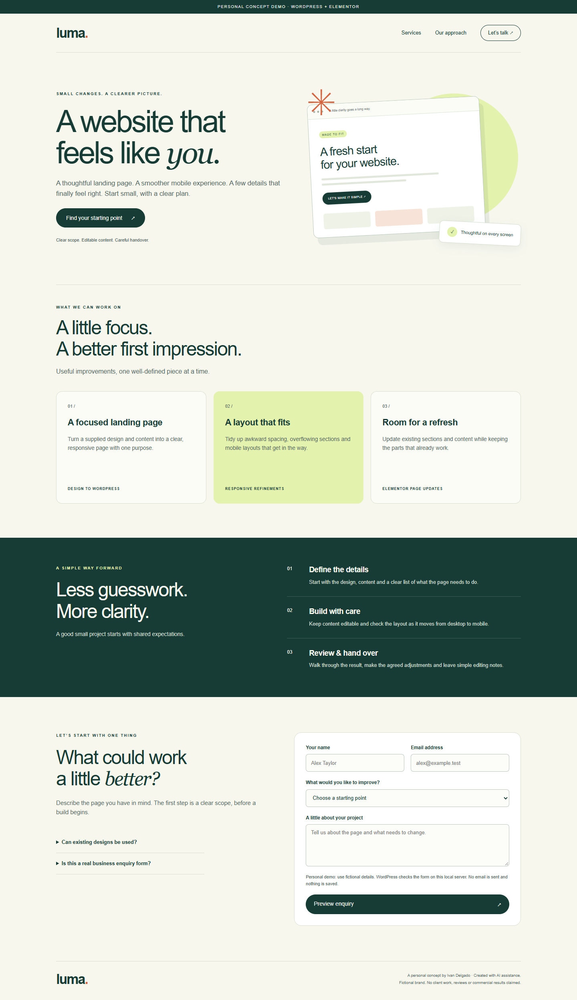

# Luma — an editable WordPress landing page

A personal WordPress / Elementor demonstration by **Ivan Delgado**, created with AI assistance. Luma is a fictional service brand. The project shows a focused landing page, mobile layout work and a small WordPress REST integration.

[](https://github.com/ivaaandeelgado/freelance-wordpress-landing-demo/actions/workflows/checks.yml)



## Try it in your browser

[**Open the interactive Luma demo**](https://playground.wordpress.net/?mode=seamless&blueprint-url=https%3A%2F%2Fraw.githubusercontent.com%2Fivaaandeelgado%2Ffreelance-wordpress-landing-demo%2Fmain%2Fdocs%2Fplayground.json)

Allow the initial WordPress and Elementor download to finish. Try the service links, open a FAQ and submit fictional details to see PHP validation. No installation or account is needed. WordPress Playground runs this separate demo in your browser; it does not send email, save enquiries or take payments. Keep real personal details out of the demo.

To inspect the editable WordPress page, [open with Playground controls](https://playground.wordpress.net/?blueprint-url=https%3A%2F%2Fraw.githubusercontent.com%2Fivaaandeelgado%2Ffreelance-wordpress-landing-demo%2Fmain%2Fdocs%2Fplayground.json) and go to `/wp-admin/`. The synthetic admin is signed in automatically. Browser state may persist locally; this is a portfolio sandbox, not production hosting.

## What works

- Editable Elementor containers, headings, service cards, buttons and FAQ content.
- Responsive layout, anchor navigation and an original CSS illustration; no external fonts or stock images.
- Enquiry preview validated by an actual PHP endpoint, including field limits, allowed services, nonce verification and a honeypot.
- Clear pending, field-error, connection-error and success states; retry preserves the visitor's text.
- Reproducible WordPress setup and an exportable Elementor template with its companion plugin.

The form sends synthetic input **only to the demo WordPress runtime** (in your browser, or on localhost with the setup below). It does not email anyone, save enquiries or contact third-party services.

## Run in three steps

Requires **Node.js 24**, npm and internet access for the initial WordPress / Elementor downloads.

```sh
npm ci
npm start
# Wait for "Personal Elementor demo ready", then open http://127.0.0.1:9417
```

On Windows PowerShell, use `npm.cmd` if script execution is disabled. `npm start` builds the blueprint automatically. Stop with Ctrl+C. The runtime binds to loopback and is recreated on every start.

For the local editor, visit `/wp-admin/` and use the **synthetic disposable** login `admin` / `local-demo-only`. Open **Pages → Luma → Edit with Elementor**. Export editor-only changes before restarting.

## Check the behavior

Stop any manually started demo server first. Install Google Chrome, then run:

```sh
npm test
```

Seven Playwright checks cover the rendered Elementor page, desktop/mobile layout, valid and invalid submissions, server-side validation, missing nonce, honeypot, payload limits and a failed-request retry. Tests start and stop their own server. Screenshots and JSON results go to ignored `evidence/`.

CI uses Playwright Chromium on a standard Ubuntu runner. It runs checks only; no hosting or deployment is configured. The local verification summary is in [docs/verification.json](docs/verification.json).

`npm run build:browser` refreshes the published browser blueprint from the same application source. `npm run check:browser` checks the public Playground link using installed Chrome; add `-- --local-blueprint` to inspect an unpublished blueprint first. Reports go to ignored `test-results/playground/`.

## How it is built

| File | Responsibility |
| --- | --- |
| `build-blueprint.mjs` | Native Elementor content and disposable WordPress setup |
| `luma-demo.php` | Namespaced plugin and `POST /wp-json/luma-demo/v1/enquiries` |
| `demo.js` | Input feedback, pending state and retry behavior |
| `demo.css` | Responsive design and CSS illustration |
| `serve.mjs` | Loopback-only Playground runtime |
| `tests/` | Browser and HTTP behavior checks |

The endpoint is enabled only by the demo's `luma_demo_mode` option. Nonces are a request check, not authentication or rate limiting for a production contact service.

`npm run build` generates `artifacts/elementor-template.json` and `artifacts/personal-landing-demo/`. Importing the template into another WordPress instance also requires Elementor and the companion plugin. The disposable runtime is for inspection, not storage of real enquiries.

## Handover scope

For projects that need the native block editor, see the [small core-block editing example](examples/native-blocks/README.md). It uses the Kadence theme and includes a checked tablet-viewport editing flow. Physical iPad/Safari verification remains a separate acceptance check.

For a real landing-page task, agree the supplied design/content, target breakpoints and acceptance checks first. Real email delivery, persistence, spam controls and production deployment are separate integrations. This demo claims no customers, testimonials or commercial results. Mobile checks emulate a viewport rather than a physical device.

[Mobile screenshot](docs/screenshots/mobile.png) · [Validated enquiry](docs/screenshots/enquiry-validated.png)

Original demo code is **GPL-2.0-or-later**; see [LICENSE](LICENSE). Dependencies retain their licenses. Implementation references: [WordPress Playground CLI](https://wordpress.github.io/wordpress-playground/developers/local-development/wp-playground-cli/) and [Elementor data structure](https://developers.elementor.com/docs/data-structure/).
